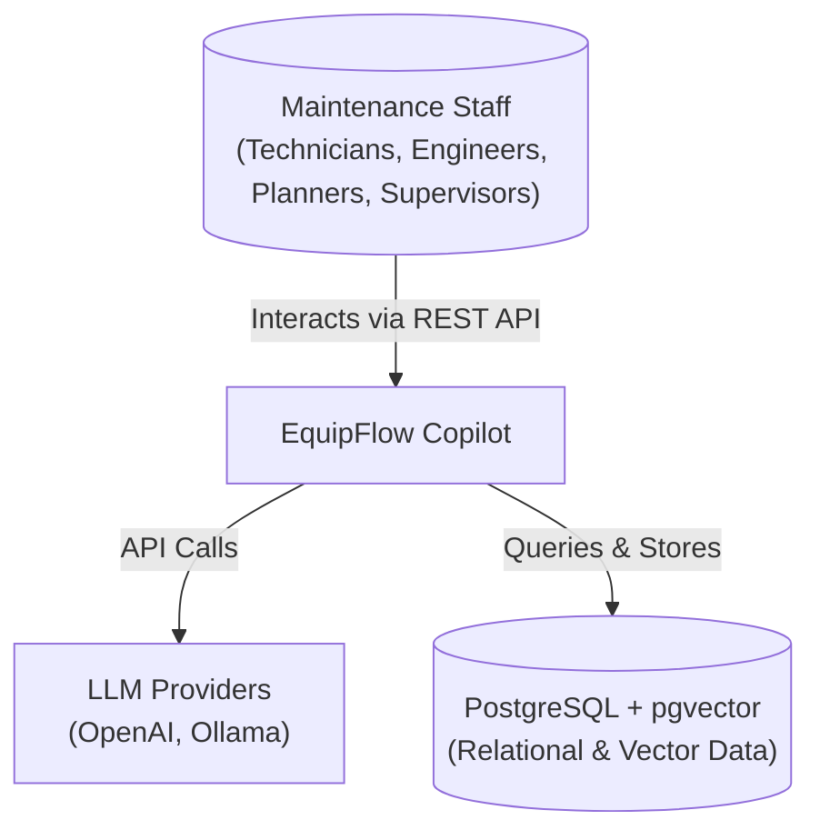
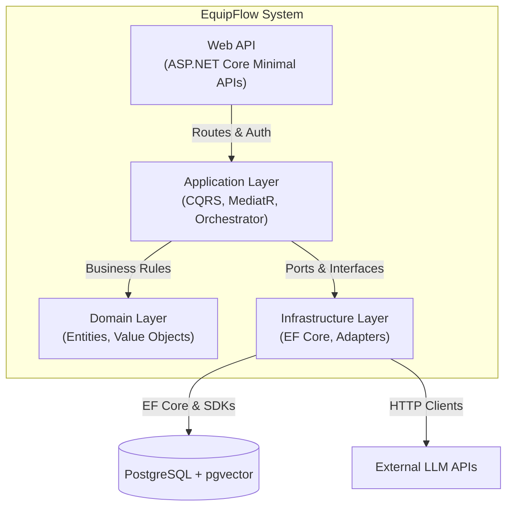
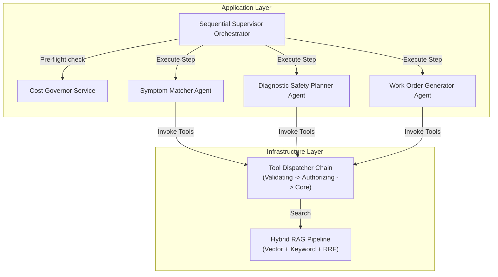
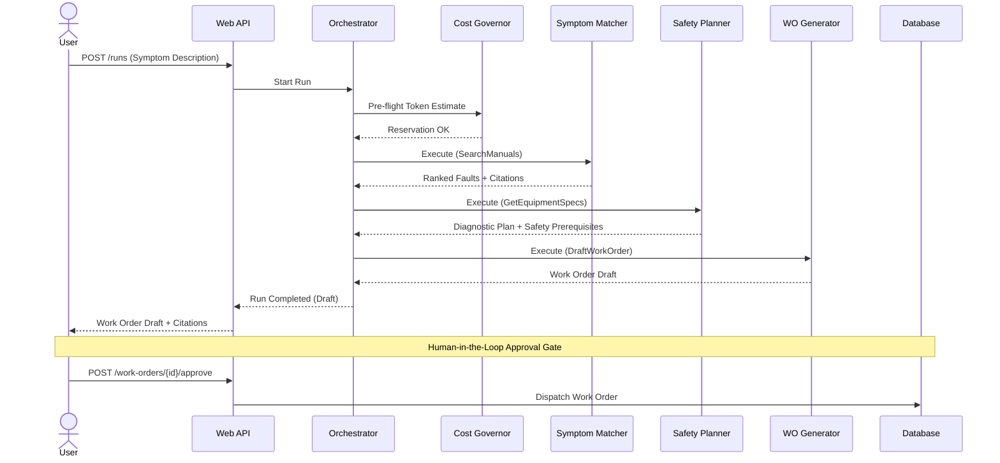
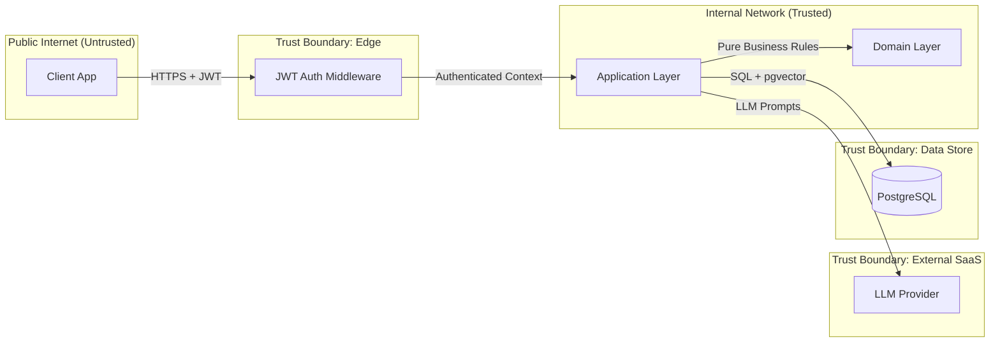
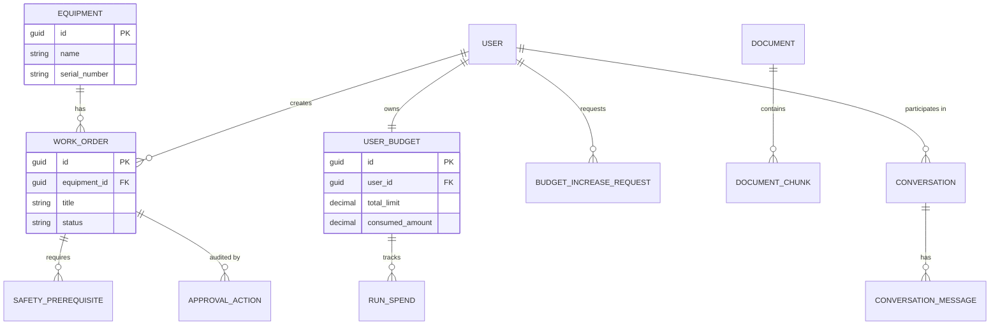
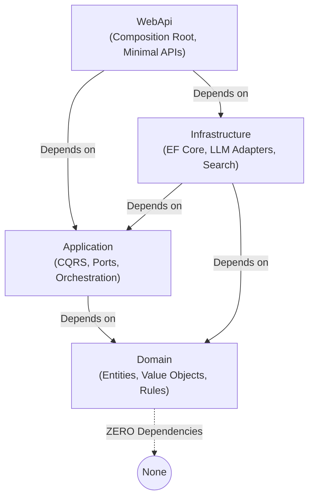

# EquipFlow Architecture Document

## 1. Overview
EquipFlow is an AI-powered industrial maintenance copilot implementing the D5 (Industrial Field Maintenance) domain with the T3 (Cost Governor) twist. This document provides a high-level architectural overview of the system using the C4 model, sequence diagrams, data-flow diagrams, and entity-relationship diagrams.

## 2. C4 Model

### 2.1 Level 1: System Context
The System Context diagram shows the high-level interaction between EquipFlow, its users, and external systems.

### 2.2 Level 2: Container
The Container diagram shows the high-level technical building blocks of the system.

### 2.3 Level 3: Component (Agentic Coordination Layer)
The Component diagram details the internal structure of the Agentic Coordination Layer within the Application/Infrastructure layers.

## 3. Agentic Workflow Sequence
This sequence diagram illustrates the multi-agent orchestration process, including the Cost Governor pre-flight checks, tool execution, and the mandatory human approval gate.

## 4. Data-Flow & Trust Boundaries
This diagram highlights the data flow through the system and the trust boundaries enforced by Clean Architecture and security middleware.

## 5. Entity-Relationship (ER) Diagram
The ER diagram illustrates the core domain entities and their relationships as defined in the EF Core DbContext.

## 6. Layer-Dependency Diagram (Clean Architecture)
EquipFlow strictly adheres to Clean Architecture principles. Dependencies only point inwards towards the Domain.

